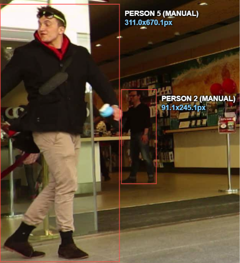
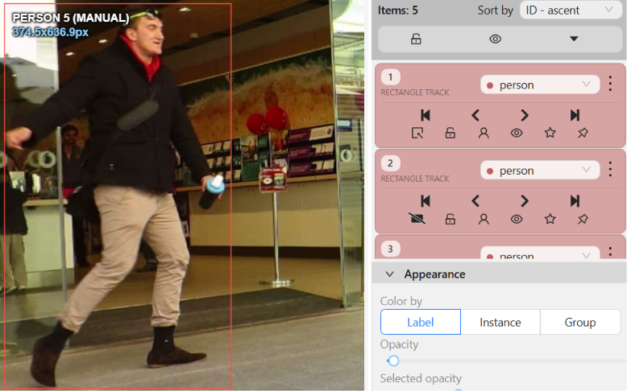
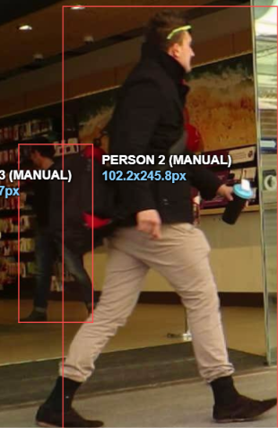

# Báo cáo cá nhân — DaoQuangTuan-2A202603194

Đoạn video: MOT17-09, 150 frame (frame 1–150), nguồn MOTChallenge, giấy phép CC BY-NC-SA 3.0.

> Số frame trong báo cáo ghi **theo CVAT (0–149)**, giống `src/check_submission.py`. Trong `gt.txt`, `frame_id` = frame CVAT + 1.

## 0. Thông tin học viên

- Họ tên: Dao Quang Tuan
- MSSV: 2A202603194
- Mã đề (A/B/C): **C** (task `DAY05-MOT17-09-C-2A202603194`, MOT ID 1, 7, 20, 22, 23)
- Email:daotuan6325@gmail.com
- Link repository: `https://github.com/DaoTuan439/K5-L2-DAY05-DaoQuangTuan-2A202603194-MOTTracking`
- Giờ bắt đầu:16:00
- Giờ kết thúc:18:00

## 1. Xem trước đoạn video (CP0)

Ghi **trước khi vẽ**, mỗi người một dòng. Số frame đã đối chiếu lại với job cuối cùng.

| Mã  | Frame xuất hiện              | Frame cuối thấy được | Rẽ / dừng / đổi tốc độ ở frame                                              | Bị che ở frame                                                                                 | Ghi chú                                                                                 |
| --- | ---------------------------- | -------------------- | --------------------------------------------------------------------------- | ---------------------------------------------------------------------------------------------- | --------------------------------------------------------------------------------------- |
| P1  | 0                            | 149                  | Đứng trong shop, đi dần về phía cửa từ khoảng frame 100 (box to dần)        | 33–49 (khuất hẳn 40–44)                                                                        | Áo đen dài tay, quần jean, trong shop Vodafone sau cửa kính. P5 đi ngang phía trước che |
| P2  | 46                           | 149                  | Đứng sau quầy rồi bước ra, đi về phía cửa                                   | 51–71 (bị quầy che chân)                                                                       | Người trong shop, sát mép trái cửa kính. Nhìn xuyên qua kính, không gán hình phản chiếu |
| P3  | 0 (ở mép phải, vào dần)      | 149                  | Đi thẳng lại gần camera, box cao từ khoảng 385 px lên khoảng 937 px         | –                                                                                              | Ông đội mũ, áo sơ mi xanh dương kẻ sọc                                                  |
| P4  | 0                            | 138                  | Đi chậm, đứng cạnh bé gái trước Woolworths                                  | 95–105 bị bà áo xanh che; khuất hẳn 106–136; 137–138 lộ một phần; từ 139 không còn thấy        | Áo xám, quần jean, túi hồng. Không gán bé gái                                           |
| P5  | 0 (ở mép trái, ra vào khung) | 149                  | Đổi hướng, vung tay khi đi; đi sang phải phía sau bà áo xanh và ông áo xanh | 0–9 bị cắt mép khung; 115–119 và 126–136 bị che; khuất hẳn 120–125 và 137–148; 149 lộ một phần | Áo khoác đen, quần be, khăn và túi đỏ                                                   |

## 2. Keyframe và thời gian (CP1, CP4)

Số keyframe lấy từ kết quả `src/check_submission.py`. Cột "Track ID" là ID trong `gt.txt`. Trên giao diện CVAT, ID hiển thị có thể khác, ví dụ P5 hiện là PERSON 5, vì track người mẫu đã xóa ở CP0 vẫn giữ một số. Khi xuất, CVAT đánh số lại.

| Mã       | Track ID (`gt.txt`) | Số keyframe | Keyframe ở frame                                                                       | Số frame có mặt | Keyframe / 100 frame | Thời gian (phút) | Chỗ khó                                                         |
| -------- | ------------------: | ----------: | -------------------------------------------------------------------------------------- | --------------: | -------------------: | ---------------- | --------------------------------------------------------------- |
| P1       |                   2 |          18 | 0, 20, 30, 33, 45, 46, 47, 50, 51, 59, 69, 79, 89, 99, 119, 129, 139, 149              |             145 |                 12.4 | không ghi riêng  | Bị P5 che hoàn toàn 40–44, hiện lại sau lưng P5                 |
| P2       |                   5 |          14 | 46, 51, 56, 67, 72, 73, 77, 87, 97, 107, 117, 127, 137, 147                            |             104 |                 13.5 | không ghi riêng  | Nhỏ, sau kính, chân bị quầy che 51–71, phải ước lượng tới sàn   |
| P3       |                   3 |          16 | 0, 20, 30, 40, 50, 60, 70, 80, 90, 100, 110, 120, 126, 130, 140, 149                   |             150 |                 10.7 | không ghi riêng  | Lại gần camera nên kích thước box đổi liên tục                  |
| P4       |                   1 |          13 | 0, 10, 20, 30, 40, 50, 60, 70, 80, 90, 95, 100, 137                                    |             108 |                 12.0 | không ghi riêng  | Bị bà áo xanh và ông áo xanh che nhiều lần                      |
| P5       |                   4 |          20 | 0, 10, 20, 30, 40, 50, 51, 60, 70, 80, 90, 100, 110, 115, 126, 127, 128, 133, 136, 149 |             132 |                 15.2 | không ghi riêng  | Đổi hướng, vung tay, ra vào mép khung, bị che hai lần cuối đoạn |
| **Tổng** |                     |      **81** |                                                                                        |         **639** |             **12.7** | **≈ 94**         |                                                                 |

Thời gian: tôi không bấm giờ riêng cho từng người nên không ghi số phút theo người. Tổng thời gian lấy từ mốc thật của CVAT và file xuất:

- Gán 5 người (gồm cấu hình CP0): 16:46 → 17:49, khoảng **63 phút** (tạo task → xuất file lần đầu).
- Review và sửa (CP3): 17:49 → 18:20, khoảng **31 phút** (xuất lần đầu → lần sửa cuối trên CVAT).

Keyframe / 100 frame của cả bài = tổng keyframe ÷ tổng số frame có mặt × 100 = 81 ÷ 639 × 100 = **12.7**

Bạn đặt keyframe nhiều nhất ở người nào? Vì sao (người đó rẽ, dừng, lại gần camera hay bị che)?

Nhiều nhất ở **P5 (20 keyframe)**:

- Đầu đoạn, P5 bị cắt ở mép trái khung (frame 0–9).
- P5 vung tay và đổi hướng khi đi, nên box đổi bề rộng nhiều.
- Cuối đoạn, P5 bị bà áo xanh rồi ông áo xanh che hai lần (115–148). Vì vậy keyframe dày ở 126, 127, 128, 133, 136 để box không trôi khi P5 vào và ra khỏi chỗ che.

Tiếp theo là **P1 (18 keyframe)**: keyframe dày quanh đoạn bị P5 che (33, 45, 46, 47, 50, 51).

## 3. Đoạn bị che (CP2)

Người bị che: `P1` (track ID 2 trong `gt.txt`, PERSON 2 trên CVAT)

| Mốc                                      | Frame |
| ---------------------------------------- | ----: |
| Bắt đầu bị che một phần (bật `occluded`) |    33 |
| Mất hẳn (bật `outside`)                  |    40 |
| Hiện lại (tắt `outside`)                 |    45 |
| Thấy rõ trở lại (tắt `occluded`)         |    50 |

- Thời gian khuất hẳn: 5 frame (40–44) = 0,17 giây.
- Quyết định: **giữ cùng ID**.
- Lý do:
  1. **Khuất bao lâu:** 5 frame, thấp hơn nhiều so với ngưỡng 60 frame (2 giây).
  2. **Ngoại hình:** trước và sau đoạn che đều là người áo đen dài tay, quần jean, đứng trong shop Vodafone sau cửa kính.
  3. **Chỗ hiện lại:** P1 gần như đứng tại chỗ trong shop. Người che là P5 đi ngang phía ngoài kính. P1 hiện lại đúng vị trí cũ ngay sau lưng P5, kích thước box gần như không đổi.

Ảnh chụp màn hình (MOT17, MOTChallenge (Milan et al., 2016)):





## 4. Tự review ID (CP3)

Lượt 1 theo người (đi ngược từ frame 149 về 0 trên CVAT), lượt 2 theo cảnh (nhảy 10 frame). Ít nhất 3 dòng; không có lỗi thì ghi một dòng "đã kiểm hai lượt, không lỗi".

Loại lỗi dùng đúng một trong 7 mã: `id_switch`, `fragmentation`, `lost`, `merge`, `false_track`, `drift`, `flag`.

| Frame | Mã người | Loại lỗi | Mô tả một câu                                                                                      | Phát hiện ở lượt | Đã sửa?                                 |
| ----: | -------- | -------- | -------------------------------------------------------------------------------------------------- | ---------------- | --------------------------------------- |
|    35 | P1       | `flag`   | Người bị che một phần nhưng chưa bật cờ `occluded` (`Q`). | Lượt 1 | Có, đã bật `Q` cho đoạn bị che một phần |
|    47 | P2       | `lost`   | Người vẫn thấy được qua tấm kính nhưng chưa có box vì không để ý. | Lượt 1 | Có, đã gán box cho đoạn đó |
|   137 | P4       | `lost`   | Cô gái (P4) để `outside` tới hết đoạn, chưa cho hiện lại khi đã lộ ra cạnh bé gái ở frame 137–138. | Lượt 2 | Có, đã tắt `outside` ở frame 137 |
|   124 | P4       | `flag`   | Chưa ẩn (chưa bật `outside`) cô gái cầm túi hồng khi bị cô áo xanh che khuất hoàn toàn, box vẫn hiện ở frame 124–129. | Lượt 2 | Có, đã bật `outside` ở frame 124 |

Tổng hợp số lỗi theo loại:

| `id_switch` | `fragmentation` | `lost` | `merge` | `false_track` | `drift` | `flag` |
| ----------: | --------------: | -----: | ------: | ------------: | ------: | -----: |
|           0 |               0 |      2 |       0 |             0 |       0 |      2 |

Lỗi nào chỉ lượt 2 (theo cảnh) mới thấy, lượt 1 (theo người) không thấy? Vì sao?

Lỗi chưa ẩn cô gái cầm túi hồng (P4) khi bị cô áo xanh che khuất (frame 124–129) chỉ lượt 2 mới thấy. Vì sao: ở lượt 1, tôi chỉ theo dõi P4 nên không để ý cô áo xanh đang che P4 hoàn toàn; đến lượt 2 nhìn cả 5 người cùng lúc mới thấy P4 đã khuất hẳn sau cô áo xanh mà box vẫn hiện.

## 5. File xuất và kết quả tự kiểm (CP4)

| Kiểm tra                                                  | Kết quả                                                                                 |
| --------------------------------------------------------- | --------------------------------------------------------------------------------------- |
| Tên file MOT 1.1                                          | `src/exports/DaoQuangTuan_mot.zip` (chỉ có `gt/gt.txt`, `gt/labels.txt`, không kèm ảnh) |
| Tên file CVAT for video 1.1                               | `src/exports/DaoQuangTuan_cvat_video.zip` (chỉ có `annotations.xml`, không kèm ảnh)     |
| Số track ID khác nhau trong `gt/gt.txt` (phải là 5)       | 5                                                                                       |
| Frame `outside` không có dòng trong `gt.txt` (đúng / sai) | Đúng. Ví dụ P1 (ID 2) không có dòng nào ở frame CVAT 40–44                              |
| Job đã completed trên CVAT máy cá nhân                    | Có                                                                                      |

Dán phần tóm tắt in ra từ `src/check_submission.py`:

```text
=== File MOT 1.1: DaoQuangTuan_mot.zip ===
  Số track ID: 5   |   Tổng số box: 639
  [OK]        Đúng 5 track ID.

  Track | Frame có mặt | Số frame | Đoạn vắng (outside)
      1 |   0–138      |      108 | 106–136
      2 |   0–149      |      145 | 40–44
      3 |   0–149      |      150 | -
      4 |   0–149      |      132 | 120–125, 137–148
      5 |  46–149      |      104 | -

=== File CVAT for video 1.1: DaoQuangTuan_cvat_video.zip ===
  Tổng: 81 keyframe / 639 frame có mặt = 12.7 keyframe / 100 frame
  [OK]        Đọc được 5 track từ annotations.xml.

=== Tóm tắt ===
  Lỗi: 0   |   Cảnh báo: 0
  Đạt. Dán phần tóm tắt này vào báo cáo mục 5.
```

## 6. Ba câu kết

1. Nếu được gán lại, bạn sẽ đặt keyframe khác ở đâu? Vì sao?

   Nếu được gán lại, tôi sẽ bổ sung keyframe tại những thời điểm người đi bộ bắt đầu bị che khuất hoặc xuất hiện trở lại, đặc biệt ở các frame có nhiều người di chuyển gần nhau.

   Tôi sẽ chú ý P4 khi bị khuất ở frame 106–136 và xuất hiện lại ở frame 137–138, cũng như P5 khi bị ông P3 che khuất ở frame 137–148 và xuất hiện lại ở frame 149. Bổ sung keyframe tại những thời điểm này giúp bounding box bám sát đối tượng hơn, hạn chế lỗi nội suy và đảm bảo track ID được liên tục.

2. Có chỗ nào bạn không chắc "cùng ID hay ID mới"? Bạn đã quyết định và ghi chú thế nào?

   Có. P5 bị ông P3 che khuất trong các frame 137–148 và xuất hiện trở lại ở frame 149. Tôi quyết định giữ nguyên ID của P5 vì đây vẫn là cùng một người, dựa trên trang phục (áo khoác đen, quần màu be), vị trí và hướng di chuyển trước và sau khi bị che khuất.

   Tương tự, P4 bị khuất ở frame 106–136 và xuất hiện lại ở frame 137–138 cạnh bé gái. Tôi vẫn giữ ID của P4 vì trang phục, vị trí xuất hiện và quỹ đạo di chuyển phù hợp với đối tượng trước đó. Cả hai đoạn khuất đều dưới ngưỡng 60 frame.

   Tôi ghi chú các frame bị che khuất để kiểm tra tính liên tục của ID, tránh tạo ID mới không cần thiết. Nếu xác định hai track thực sự thuộc cùng một người, tôi dùng chức năng Merge (phím `M`) trên CVAT thay vì xóa một track.

3. Một lỗi ID trong job của bạn (nếu không còn sót, chọn lỗi đã sửa) có thể làm xe tự lái dự đoán sai chuyển động của người đó như thế nào? Lỗi đó ảnh hưởng MOTA hay IDF1 nhiều hơn?

   Một lỗi tôi nhận thấy trong quá trình gán nhãn (đã sửa) là P4 bị đánh dấu `outside` quá sớm, trong khi thực tế người này vẫn còn xuất hiện và đứng cạnh trẻ em.

   Lỗi này khiến hệ thống tracking mất dấu P4 dù người đó vẫn ở trong khung hình. Xe tự lái có thể hiểu nhầm rằng người đi bộ đã rời khỏi khu vực, dẫn đến dự đoán sai vị trí, quỹ đạo và khoảng cách an toàn. Trong tình huống thực tế, hệ thống có thể không nhận ra nguy cơ va chạm với người đi bộ.

   Ngoài ra, nếu nhãn vị trí giữa hai frame bị nhảy đột ngột, hệ thống có thể tính sai vận tốc. Ví dụ trong `CHECKPOINTS.md` (CP3): vị trí nhảy 1,5 m chỉ trong 1/30 giây tương đương khoảng 162 km/h, một vận tốc phi thực tế đối với người đi bộ.

   Về chỉ số đánh giá:
   - MOTA: bị ảnh hưởng bởi các frame bỏ sót (false negative) khi P4 vẫn xuất hiện nhưng bị đánh dấu `outside`.
   - IDF1: bị ảnh hưởng khi việc mất dấu làm đứt đoạn danh tính, hoặc khiến P4 bị gán ID mới khi xuất hiện lại.

   Kết luận: IDF1 phản ánh rõ hơn vấn đề duy trì danh tính đối tượng xuyên suốt video; MOTA cũng giảm do các frame bị bỏ sót. Đây là lỗi quan trọng cần khắc phục vì có thể khiến xe tự lái dự đoán sai sự hiện diện và chuyển động của người đi bộ.

## Bonus (nếu làm)

Không làm.

## 7. Tài liệu tham khảo và công cụ AI đã dùng

- Tài liệu: `docs/GUIDELINE.md`, `docs/CVAT_CHEATSHEET.md`, `docs/MOT_FORMAT.md`, [CVAT docs — MOT format](https://docs.cvat.ai/docs/dataset_management/formats/format-mot/).
- Dữ liệu: MOT17-09, MOTChallenge (Milan et al., 2016), CC BY-NC-SA 3.0.
- Công cụ AI: Claude (Claude Code), dùng để:
  - sửa lỗi cài đặt môi trường Python;
  - chạy `src/check_submission.py` và `tools/lab05/timeline.py`, đọc kết quả, đối chiếu box với ảnh để chỉ ra frame cần xem lại;

  Không dùng AI hay tracker để sinh box hoặc track ID. Mục 4 và mục 6 tự viết.
